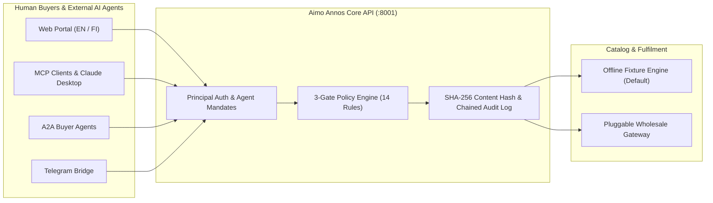

# Aimo Annos

**Trusted Trade Agents — *Delegate the work, never the responsibility.***

Aimo Annos is an open-protocol governance and procurement gateway for B2B foodservice. It lets autonomous AI agents search wholesale catalogs, build diet-safe quotes, negotiate volume terms, and place kitchen orders — while enforcing human-defined safety, operational, and financial mandates **deterministically in code, never in the LLM**.

---

## Why Aimo Annos: The 3-Gate Deterministic Policy Engine

Every quote preview and order execution — whether initiated from the Web Portal, REST API, Model Context Protocol (`MCP`), Agent-to-Agent (`A2A`), or Telegram — passes through **`14` deterministic policy rules** across three gates before anything can reach an upstream order gateway:

1. **Gate 1 — Food Safety & Allergen Integrity**
   - Enforces strict dietary non-equivalence (`L != VL != M` — lactose-free, low-lactose, and milk-free are never conflated; gluten-free, vegan, and nut-free rules are checked per SKU).
   - Blocks items with incomplete allergen/Synkka metadata when a hard dietary mandate is active.
2. **Gate 2 — Supply & Kitchen Operations**
   - Validates delivery `closing_time` cut-offs, unit-of-measure alignment, and recipe headcount yield sanity (`R-RECIPE-SANITY`).
   - Reserves platform stock for **5 hours (`HELD_5H`)** while awaiting manager sign-off (with fair-use anti-hoarding guardrails) and offers **1-tap verified `ON_TIME` diet-safe substitutes**.
3. **Gate 3 — Financial Mandates & Cryptographic Auditability**
   - Enforces per-agent EUR auto-approve ceilings, human-approval bands, hard block caps, and **Order Assurance (`50–100`)** thresholds.
   - Binds every human approval to a canonical **64-character SHA-256 `content_hash`** (`409 Conflict` if a single line or price drifts), quarantines anomalous agent behavior in real time, and records every action in a **hash-chained audit log**.



---

## Open Interfaces

| Interface | Endpoint / Artifact | Highlights |
| :--- | :--- | :--- |
| **REST / OpenAPI 3.1** | `/api/docs`, `/api/openapi.json` | Typed JSON endpoints for human buyers (`usr_*`), delegated agents (`agt_*`), quotes, orders, approvals, and audit trails |
| **Model Context Protocol (`MCP 2025-03-26`)** | `POST /api/mcp` + `clients/mcp/` | `10` procurement tools over Streamable HTTP plus a zero-dependency stdio bridge and 1-click Claude Desktop plugin `.zip` |
| **Agent-to-Agent (`A2A`)** | `POST /api/a2a`, `/.well-known/agent-card.json` | JSON-RPC 2.0 autonomous quote discovery, mandate inspection, and structured counter-offer negotiation |
| **Web Purchasing Portal (`EN / FI`)** | `http://127.0.0.1:8000` | Bilingual hospitality purchasing UI, agent mandate studio, Order Assurance controls, and 1-scan QR pairing |
| **Telegram Customer & Approval Bridge** | `scripts/telegram_bridge.py` | Optional private-chat bridge for ISO 18004 QR pairing, multi-branch switching, chat ordering, 1-tap `content_hash` approvals, and pre-cutoff Undo |

---

## Repository Structure

| Directory | Description | Documentation |
| :--- | :--- | :--- |
| `backend/` | FastAPI Core API, 3-Gate Deterministic Policy Engine (`14` rules), SQLite/MySQL persistence, MCP & A2A protocol servers, and offline fixture adapter | [`backend/README.md`](backend/README.md) |
| `frontend/` | React 18 + TypeScript + Vite + Tailwind CSS bilingual (`EN / FI`) purchasing portal, agent governance console, and MSW standalone mock mode | [`frontend/README.md`](frontend/README.md) |
| `clients/` | Zero-dependency Python stdio-to-HTTP MCP bridge (`clients/mcp/`), Claude Desktop plugin packager, and portable agent skills (`clients/skills/`) | [`clients/README.md`](clients/README.md) |
| `scripts/` | Optional Telegram Customer & Approval Bridge (`telegram_bridge.py`) and offline unit test suite | [`scripts/README.md`](scripts/README.md) |

---

## Quick Start (5-Minute Local Setup · 100% Offline-Capable)

> [!NOTE]
> **Bring Your Own Catalog Data:** Proprietary wholesale datasets and live upstream supplier endpoints are intentionally omitted from this public repository. By default, `AIMO_MODE=fixture` runs **100% offline** with deterministic pricing, stock, delivery cut-offs, and `LLM_PROVIDER=fake` assistant responses — no external API keys required. See [`backend/README.md`](backend/README.md) for the exact catalog JSON/CSV schema.

### 1. Backend Setup

Requirements: **Python 3.11+** and [`uv`](https://docs.astral.sh/uv/).

```bash
cd backend
uv sync
cp .env.example .env
```

### 2. Seed Catalog & Demo Tenants, Then Start FastAPI

If you have your own Synkka/GS1-compatible product catalog JSON (and optional carbon footprint / delivery reliability CSVs), load them first; then run `demo_seed.py` to create demo hospitality tenants, multi-branch kitchens, and delegated AI agents:

```bash
# Optional: load your own catalog JSON/CSV files (see backend/README.md for schema details)
uv run python scripts/seed_catalog.py --products ../catalog_data/products.json

# Seed demo organizations, buyer accounts, and delegated trade agents
uv run python scripts/demo_seed.py

# Start the Core API on http://127.0.0.1:8001 (OpenAPI UI at http://127.0.0.1:8001/api/docs)
uv run uvicorn app.main:app --host 127.0.0.1 --port 8001
```

### 3. Frontend Setup

Requirements: **Node.js 20+** and `npm`. Open a second terminal:

```bash
cd frontend
npm install
npm run dev
```

Open **`http://127.0.0.1:8000`** and sign in with a seeded demo buyer account (default password: `demo1234`):

| Buyer Account | Organization | Profile |
| :--- | :--- | :--- |
| `anna.korhonen@hotel.fi` | Hotel Aurora Oy | Multi-branch hotel group with delegated breakfast & banquet agents |
| `mikko.laine@restaurant.fi` | Bistro Satama Oy | Waterfront restaurant kitchen |
| `sari.virtanen@festival.fi` | Nordic Campus Catering Oy | High-volume campus & event catering |

Want to explore the UI without running Python? Launch standalone mock mode instead:

```bash
VITE_USE_MOCKS=true npm run dev
```

### 4. Connect External Agents & Optional Telegram Bridge

- **MCP / Claude Desktop / A2A Agents:** Mint an agent mandate token in the Web Portal (or inspect `backend/.demo_credentials` after seeding) and follow [`clients/README.md`](clients/README.md) to connect via `/api/mcp` or install the 1-click Claude Desktop `.zip` bundle.
- **Telegram Customer & Approval Bridge (Optional):** Create a Telegram bot via `@BotFather`, set `TELEGRAM_BOT_TOKEN`, and follow [`scripts/README.md`](scripts/README.md) to enable 1-scan QR pairing and 1-tap `content_hash` mobile approvals.

---

## Running Tests

All test suites run **offline** without external API keys or network calls:

```bash
# 1. Backend API, 14 policy rules, MCP, A2A & hash-chained audit tests
(cd backend && uv run pytest)

# 2. Frontend unit/integration tests (Vitest + MSW) & strict TypeScript check
(cd frontend && npm test && npm run typecheck)

# 3. MCP stdio bridge & Claude Desktop bundle tests
uv run --project backend pytest clients/mcp

# 4. Telegram Customer & Approval Bridge offline unit tests
uv run --project backend pytest scripts/test_telegram_bridge.py
```
